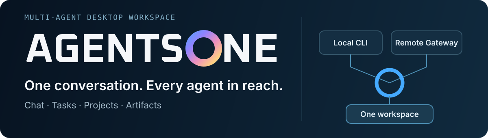
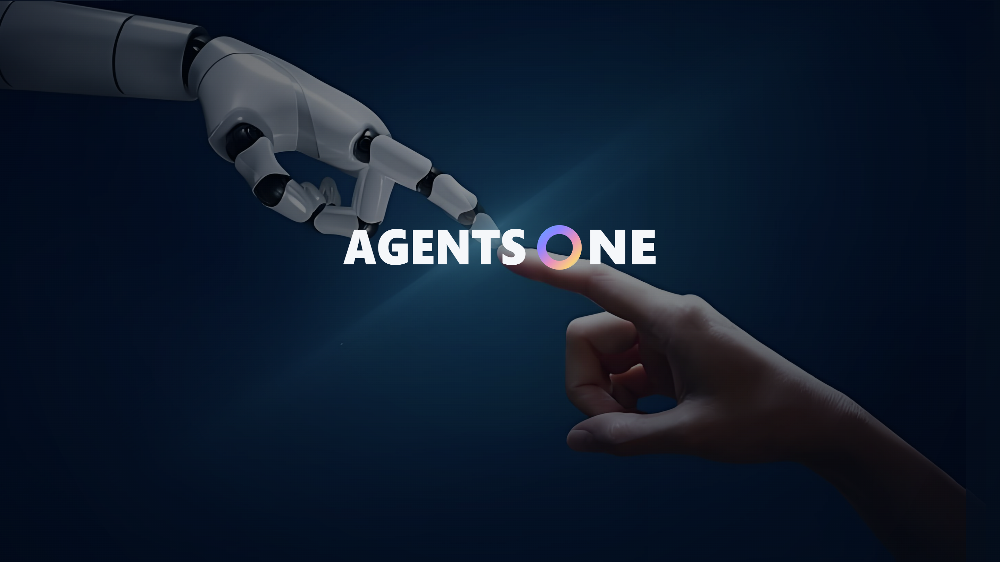
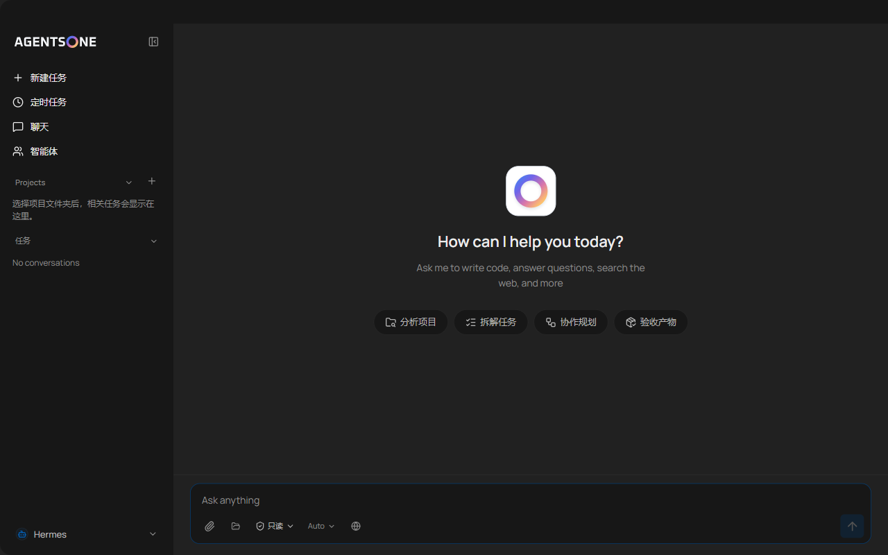
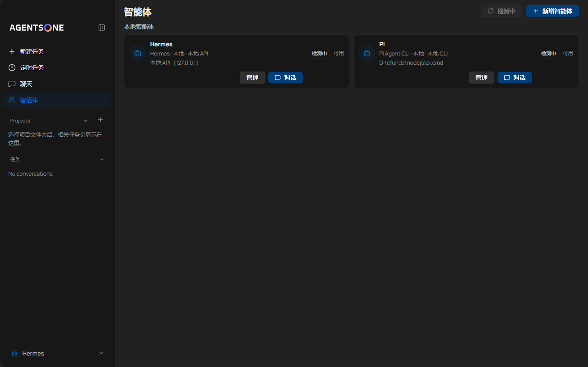

# Agents One

<p align="center">
  
</p>

<p align="center">
  <a href="README.zh-CN.md">简体中文</a> · <a href="#see-it-in-action">Preview</a> · <a href="#get-started">Get started</a> · <a href="#development">Develop</a> · <a href="#license">License</a>
</p>

**Manage local and remote AI agents in one workspace.** Connect Pi Agent, Codex, Claude Code, OpenCode and more to organize conversations, tasks, collaboration and artifacts. Each agent keeps its own tools and permissions.

## Ask an AI agent to help you get started

You can send the prompt below to your agent so it can help install, configure and deploy Agents One for your needs.

```text
Please read https://github.com/pkulyn/agents-one/blob/main/README.md first,
then help me install and configure Agents One for my environment. Check my system
and existing tools, download the appropriate Windows or Android package from the
official GitHub Releases, and verify its SHA-256. Help me connect the local or
remote agents I need; if applicable, deploy the plugin, Connector and Connect,
and help install, connect and pair the phone app. First ask what features I need;
do not deploy components I do not need. Preserve existing configuration and data.
Explain any steps that require my account, secrets, server access or my own action;
do not write credentials to source files, documentation or logs. Verify each step
and report what is complete, what was tested and what still needs my attention.
```

## See it in action

The opening scene of the current app carries the Agents One Dawn Ring identity:

<p align="center">
  
</p>

Conversations stay central, with projects, scheduled work and agent selection close at hand.

<p align="center">
  
</p>

<details>
<summary>View the agent registry</summary>

<p align="center">
  
</p>

</details>

Screenshots show development builds; labels and layout may change between releases.

## What comes together

| Your work            | What Agents One adds                                                                                          |
| -------------------- | ------------------------------------------------------------------------------------------------------------- |
| **Conversations**    | Streaming replies, tool activity, artifacts, searchable history, retry/cancel controls and terminal fallback. |
| **Agents**           | One registry for local CLIs and remote Gateway v1 agents, with health and reported capabilities.              |
| **Projects & tasks** | Folder-scoped workspaces, scheduled runs, archives and multi-agent handoffs.                                  |
| **Your data**        | Portable backup and restore with integrity checks and rollback safeguards.                                    |

### Local power, one shared surface

Local CLIs run as native processes and retain their models, tools, project instructions and permissions. Remote agents connect through Gateway v1, which negotiates capabilities and grants workspace access for bounded runs. Both use the same conversation interface.

The [Plugin SDK](docs/AGENTS_ONE_PLUGIN_SDK.md) lets additional agents implement this contract without changing the desktop app. The [event stream](docs/AGENT_EVENT_STREAM_V1.md) carries tool activity, artifacts, and handoffs; the [Gateway protocol](docs/AGENTS_ONE_REMOTE_GATEWAY_V1.md) covers remote runs and workspace grants.

## Get started

[Windows installation](#install-and-verify-on-windows) · [Local agents](#connect-a-local-agent) · [Remote agents and servers](#connect-a-remote-agent-components-and-deployment) · [Android](#android-install-and-connect-to-the-desktop)

### Release status

| Component         | Current status                                                                                                                                                                     |
| ----------------- | ---------------------------------------------------------------------------------------------------------------------------------------------------------------------------------- |
| Windows desktop   | [0.1.0 stable Release](https://github.com/pkulyn/agents-one/releases/tag/v0.1.0), with x64 installer and portable EXE.                                                             |
| Android           | [0.1.13-dev-debug APK](https://github.com/pkulyn/agents-one/releases/tag/android-v0.1.13-dev), Android 8.0 / API 26 or newer. Debug-signed, debuggable prerelease.                 |
| Remote components | Plugin SDK **0.1.6**, Connector CLI **0.1.0**, Connect service **0.1.1**. Deploy from this repository; do not assume a published npm package or a project-operated public service. |
| Other platforms   | No public macOS/Linux desktop or iOS binaries. Linux can host self-managed remote services.                                                                                        |

Windows core flows have passed acceptance within a limited scope; other models, remote services, upgrade/restore paths and mobile combinations are not all qualified. See [known issues](KNOWN_ISSUES.md).

### Install and verify on Windows

1. Download one package and the matching `SHA256SUMS.txt` from the [official Release](https://github.com/pkulyn/agents-one/releases/latest):
   - `agents-one-0.1.0-setup.exe`: recommended for most users; installs for the current Windows user without a system-wide installation requirement.
   - `agents-one-0.1.0-portable.exe`: run from a writable local directory without installing. **Portable means no installer, not that data is stored beside the EXE**; see data locations below.
2. In your download directory, compare the SHA-256 against the **same filename** in the checksum file:

   ```powershell
   Get-FileHash .\agents-one-0.1.0-setup.exe -Algorithm SHA256
   # For the portable package, use the matching portable.exe filename instead
   Get-Content .\SHA256SUMS.txt
   ```

3. **SmartScreen:** unsigned Windows packages may show a warning on first launch. Verify the official Release and SHA-256 first; if Windows offers it and you trust the file, choose **More info → Run anyway**. Stop if the hash differs, security software flags the file or your organization blocks it. [Microsoft guidance](https://learn.microsoft.com/en-us/windows/apps/package-and-deploy/smartscreen-reputation)
4. Finish the installer and open the **Agents One** shortcut, or run the portable EXE directly. Use a normal user account for the desktop app and its CLIs. Single-click the tray icon to open the main window; double-click to toggle Quick Chat, then double-click again to close it. Use the tray context menu to quit normally.

**Updates:** the 0.1.0 package has no in-app update check; use [Releases](https://github.com/pkulyn/agents-one/releases) and install updates manually. Newer source builds can check from **Settings → About & Updates → Check for updates** and link to GitHub; they do not download or install updates automatically. Before upgrading, back up in **Settings → Data** and quit from the tray. Installer and portable builds use separate data directories. No winget or Microsoft Store package is available.

### Connect a local agent

Agents One does not provide a CLI subscription, sign in to a provider for you, or supply API keys. Install and configure each desired CLI under the **same Windows user** as the desktop app, and complete a normal conversation in its own terminal first.

| Agent type  | Common command | Before connecting                                                                 |
| ----------- | -------------- | --------------------------------------------------------------------------------- |
| Codex       | `codex`        | Complete the CLI's own sign-in or provider configuration.                         |
| Claude Code | `claude`       | Authenticate Claude Code and confirm access to the intended working folder.       |
| Pi Agent    | `pi`           | Configure Pi's provider, model and credentials.                                   |
| OpenCode    | `opencode`     | Confirm the selected provider/model works; the desktop uses native CLI protocols. |

1. Open **Agents → Add agent**, choose **Local**, then set the agent type, name and appearance.
2. Use the detected executable path, or select the actual CLI launcher. Do not select a project directory, installer or a whole shell command. On Windows, locate it with `where.exe codex`, `where.exe claude`, `where.exe pi` or `where.exe opencode`.
3. Save and test the connection. Check its health/capabilities, open Chat, select the agent and send a simple message.
4. For file work, create/select a **Project**, confirm its directory and choose the appropriate permission mode. **Read-only, Automatic and Full access** allow different operations. Automatic mode restricts moving or deleting existing files; use Full access only with an understood scope. Available tools depend on the Runtime's actual capabilities.

Fully quit and reopen the desktop app after changing CLI paths or the user PATH. If terminal use works but probing fails, check the launcher path, inherited environment and same-user authentication. Existing local Hermes installations can be discovered and adopted through their management UI; a local Hermes Home is not a remote Gateway URL.

### Connect a remote agent: components and deployment

| Component                | Runs on                                           | Purpose                                                                                                                                                                    |
| ------------------------ | ------------------------------------------------- | -------------------------------------------------------------------------------------------------------------------------------------------------------------------------- |
| Gateway plugin / Adapter | The server running the agent                      | Maps native runs, events, files and cancellation to Agents One Gateway v1. The SDK provides a contract and host, not an automatic adapter for every agent.                 |
| Connector CLI            | The remote agent server                           | Makes an outbound WSS connection to Connect and forwards requests to its configured local Gateway.                                                                         |
| Connect service          | A server reachable by the desktop and remote host | Pairing, device authorization and tunnel routing; **it does not install or execute agents**. It may share a machine with the Gateway, with separate state and credentials. |

Hermes, OpenClaw or another remote service must implement **Agents One Gateway v1**. An ordinary model API, OpenAI-compatible endpoint, chat website or arbitrary agent HTTP port is insufficient. The Hermes SDK example is an integration skeleton: the service maintainer must connect real runs and artifact interfaces. Remote OpenCode hosting has a separate experimental rollout gate; remote Pi/Codex/Claude Code adapters are not delivered integrations.

#### A. Prepare the Gateway plugin on the agent server

Use Node.js **24+** and components from the same repository revision. The SDK is not currently published to the public npm registry; do not assume `npm install @agents-one/plugin-sdk` will work.

```bash
# From the source repository root; npm.cmd also works on Windows
npm --prefix plugins/agents-one-plugin run verify
npm pack ./plugins/agents-one-plugin
# In your own Gateway / Adapter project, install the generated local file:
# npm install /absolute/path/to/agents-one/agents-one-plugin-sdk-0.1.6.tgz
```

Implement/start the Adapter using the [Plugin SDK guide](docs/AGENTS_ONE_PLUGIN_SDK.md) and [plugin deployment instructions](plugins/agents-one-plugin/README.zh-CN.md). Set a dedicated Gateway token, bounded workspace and persistent `statePath`. Verify a capability probe, conversation, cancellation and file exchange on the server first. Examples use `AGENTS_ONE_GATEWAY_TOKEN`; keep secrets out of source, documentation and prompts. Updating the desktop does not update a remote plugin.

#### B. Deploy Connect

The following starts a user-level Linux process **behind a reverse proxy**. It is a single-instance starting point, not a turnkey multi-tenant production service:

```bash
git clone https://github.com/pkulyn/agents-one.git
cd agents-one
npm ci --ignore-scripts --prefix services/agents-one-connect
mkdir -p "$HOME/.agents-one-connect"
chmod 700 "$HOME/.agents-one-connect"
export CONNECT_HOST=127.0.0.1
export CONNECT_PORT=8788
export CONNECT_STATE_FILE="$HOME/.agents-one-connect/gateway-state.json"
node services/agents-one-connect/bin/agents-one-connect.mjs
```

Reverse-proxy your own `https://connect.example.com` to `127.0.0.1:8788`, preserving request paths and WebSocket Upgrade, with a publicly trusted full TLS chain. The desktop, remote server and phone must each reach this address from their own networks.

Health check: `https://connect.example.com/connect/v1/health`. Keep the process running and preserve its state across restarts. Direct TLS is also supported through `CONNECT_TLS_KEY_FILE` and `CONNECT_TLS_CERT_CHAIN_FILE`; see the [service deployment guide](services/agents-one-connect/README.zh-CN.md). Public deployments also need ingress access controls, rate limiting, backups and process supervision. This implementation does not provide a complete account system or shared multi-instance authorization database.

#### C. Pair through the Connector

On the **agent server**, from the repository root:

```bash
npm ci --ignore-scripts --prefix plugins/agents-one-connector
node plugins/agents-one-connector/bin/agents-one-connector.mjs request-pairing --connect https://connect.example.com --runtime-id my-remote-agent --name "My remote agent" --wait true
```

On the **desktop**, quit the existing app from its tray first. Set the same Connect endpoint and launch your actual installed EXE from that PowerShell session:

```powershell
$env:AGENTS_ONE_CONNECT_ENDPOINT = "https://connect.example.com"
& "C:\path\to\agents-one.exe" # Replace with the real path; the variable applies only to this session
```

Choose **Agents → Add agent → Remote → Verification-code pairing**, enter the remote 10-character code, review the device fingerprint, Runtime list and expiry, then confirm. `--wait true` waits for completion and saves credentials; without it, run `complete-pairing` afterward. Use the same operating-system user for subsequent Connector commands.

Once a compatible local Gateway is running on the remote host, configure the loopback adapter and leave the Connector running:

```bash
export AGENTS_ONE_LOOPBACK_GATEWAY=http://127.0.0.1:8787
# Inject AGENTS_ONE_GATEWAY_TOKEN privately; it must match the local Gateway
node plugins/agents-one-connector/bin/agents-one-connector.mjs run --adapter ./plugins/agents-one-connector/adapters/gateway-v1-loopback.mjs
```

Save/probe the remote agent in the desktop and test a real conversation. Pairing confirms device authorization, **not Gateway/model readiness**. Use `status` and `diagnose --connect https://connect.example.com` for diagnostics; see the [Connector guide](plugins/agents-one-connector/README.zh-CN.md) for parameters and user-level startup.

Advanced users may skip Connect: choose **Self-hosted Gateway**, enter a reachable HTTPS Gateway v1 URL and its dedicated bearer token, save and probe. This is a manual direct connection, not a Connect-paired device. Never expose an unauthenticated Gateway.

### Android: install and connect to the desktop

The Android app connects to an authorized desktop **Owner**, which holds the data and runs agents. Keep the desktop online and awake; an online Connect service alone does not mean the desktop task channel is ready.

**Install:**

1. Download [agents-one-android-0.1.13-dev-debug.apk](https://github.com/pkulyn/agents-one/releases/download/android-v0.1.13-dev/agents-one-android-0.1.13-dev-debug.apk) and the matching [SHA256SUMS.txt](https://github.com/pkulyn/agents-one/releases/download/android-v0.1.13-dev/SHA256SUMS.txt) from the [Android release](https://github.com/pkulyn/agents-one/releases/tag/android-v0.1.13-dev); you do not need to build it yourself. The APK requires Android 8.0 (API 26) or newer.
2. Before installing, compare the APK's SHA-256 with the matching filename in the checksum file:

   ```text
   533d61317743b40f9e584fabaa11b109b387ab1fbc2060894ccc4c2d8f5601f0
   ```

   For example, run `Get-FileHash .\agents-one-android-0.1.13-dev-debug.apk -Algorithm SHA256` in the Windows download directory, or use a trusted local hashing tool on the phone. Stop if the hashes differ.

3. Transfer the APK to the phone or download it there. Follow Android's prompts to temporarily allow “Install unknown apps” for the browser or file manager used; you can turn that permission off after installation.

This is a **debug-signed, debuggable** prerelease with package ID `one.agents.mobile.debug`. An authorized ADB debugging connection may access app data; turn off USB debugging when it is not needed and avoid using this build for sensitive data. An in-place update requires the same package ID and signing certificate; a differently signed build may not upgrade it. Uninstalling removes the phone's local state, so back up anything you need first. No iOS or app-store download is provided.

**Connect:**

1. The administrator must enable the independent mobile service using the [Owner provisioning instructions](services/agents-one-connect/README.zh-CN.md#english-operator-checklist), then provide the HTTPS base URL and a dedicated **Owner management key**. Gateway pairing alone is insufficient.
2. On the desktop, open **Settings → Phone connection → Connection service setup**, enter the URL/key, choose **Save and connect**, and enable **Allow phone connections**. Gateway/Connector tokens cannot replace this key. Do not give the management key to the phone.
3. Select **Generate invitation**. In the Android app's **Me** connection area, enter the same HTTPS URL, invitation and device name, and request access.
4. Compare the verification phrase on both devices. Approve the device with only the required scopes on the desktop, then let the phone finish claiming access. This invitation is distinct from the remote Connector's 10-character code.
5. View tasks/schedules on the phone. When starting work, choose an available, authorized desktop agent, project and execution mode. Review/approve execution policies on the desktop when required; pairing alone does not grant execution permission.
6. Revoke lost or unused phones under **Paired devices** on the desktop. Revoking access does not cancel existing tasks; stop those separately if needed.

For cached-only views, an offline Owner or an unready task channel, check the desktop process, connection switch, networking/WebSocket proxy and service health before deleting pairings or resetting data.

## Data and trust boundaries

Desktop state lives in Electron `userData` (normally `%APPDATA%\agents-one` on Windows); portable builds use `%LOCALAPPDATA%\agents-one-portable` by default. Launch arguments or explicit data-path overrides may change these locations. Project files stay in their selected folders; CLIs retain their own configuration and may store additional data outside the desktop directory. Backups omit known credentials and protected secrets, but user-authored chats, memories, skills, and attachments can still contain sensitive information.

The built-in Doubao, ChatGPT, and Grok browser adapters are **default-off experiments** in public builds. Enabling them sends selected prompts and attachments through the signed-in provider webpage. See the [security policy](SECURITY.md), and [known issues](KNOWN_ISSUES.md) for the current boundaries and limitations.

## Development

Node.js **24 or newer** is required. From the repository root on Windows:

```powershell
npm.cmd run install:clean
npm.cmd run dev
npm.cmd run typecheck
npm.cmd test
```

See the [contribution guide](CONTRIBUTING.md) for the full checks and the [runbook](docs/AGENTS_ONE_RUNBOOK.md) for usage and troubleshooting. Changes are tracked in the [changelog](CHANGELOG.md).

## License

Original Agents One contributions in this repository are offered under the [MIT License](LICENSE). MIT permits use, modification, distribution, and commercial use when the copyright and license notice is retained. Contributors keep their own copyright and submit only material they can license under MIT.

The inherited `hermes-desktop` material retains its original author's MIT notice in [THIRD_PARTY_NOTICES.md](THIRD_PARTY_NOTICES.md). Third-party dependencies and assets retain their respective terms; the Oxanium-derived wordmark notice and font license are also linked there. This code license does not grant rights to impersonate the Agents One project or its maintainers.
