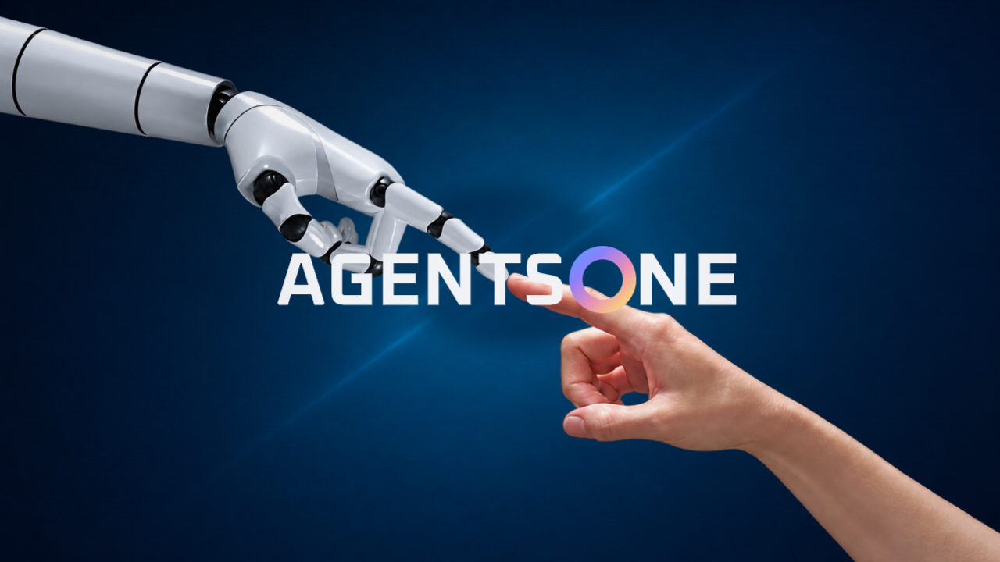
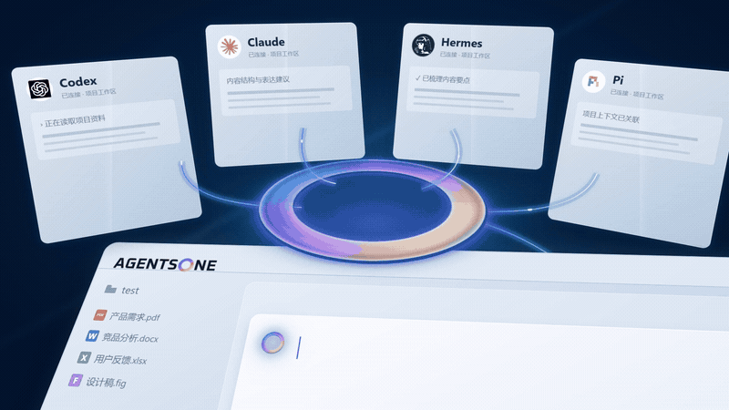

# Agents One

<p align="center">
  
</p>

<p align="center">
  <a href="https://github.com/pkulyn/agents-one/releases"></a>
  <a href="https://github.com/pkulyn/agents-one/actions/workflows/ci.yml"></a>
  <a href="https://github.com/pkulyn/agents-one/releases"></a>
  <a href="LICENSE"></a>
</p>

<p align="center">
  <a href="https://www.agentsone.cn/en.html">Website</a> · <a href="https://github.com/pkulyn/agents-one/releases/latest">Download</a> · <a href="#see-it-in-motion">Watch the film</a> · <a href="#get-started">Get started</a> · <a href="README.zh-CN.md">简体中文</a>
</p>

<h2 align="center">Start with One. Bring your agents together.</h2>

<p align="center">A personal AI agent. A shared workspace for the agents you already use.</p>

**One is built in.** Choose a model, connect your API, and start researching, coding or working with files. Bring Codex, Claude Code, Pi Agent and OpenCode into the same workspace. Keep conversations, projects, tool activity and finished work together.

## See it in motion

<p align="center">
  <a href="assets/readme/product-film.mp4"></a>
</p>

<p align="center"><a href="assets/readme/product-film.mp4"><strong>Watch the full film · 34 seconds · 1080p</strong></a></p>

A short excerpt plays here; open the full film above. This is a designed product presentation, not a recording of the current interface.

## Meet One

### Your model. Your agent. Your way of working.

One is Agents One’s own local agent, built on the Pi agent SDK. It works directly with your configured model API, so getting started does not require another agent CLI. Model access and usage come from your chosen provider.

- **Research and get things done.** Search the web, read pages, check weather, work with project files, read Word/PDF documents and create Word files. Use images with a model that supports image input.
- **Make it yours.** Edit One’s AGENTS.md, manage private and project memory, and enable the skills you need. Configure plugins and MCP servers to add capabilities.
- **Choose how it thinks.** Manage providers and models, edit context and capability metadata, and switch reasoning from Off through Medium to Max. One remembers your accepted reasoning choice.
- **Stay in the conversation.** Follow streamed replies, native progress, reasoning and tool activity. Confirm a steering message for the next tool boundary, or queue a follow-up for after the current answer.

Tools, image input and reasoning depend on the model, enabled extensions and permission mode. Max uses the highest effort supported by the model integration.

## One workspace. More possibilities.

### Keep the agents you trust

Use One alongside **Codex, Claude Code, Pi Agent and OpenCode**. Local integrations keep their own models, tools and authentication. Compatible remote agents connect through **Gateway v1**. Agents One keeps its harness thin so each agent’s native capabilities can come through.

### Give work a place to live

Choose a project folder, continue an existing conversation, schedule recurring work, or assign a task to multiple registered agents. Review progress and handoffs in the conversation, then open the resulting files from artifact cards.

### Stay close to the work

See what is running, stop a task when needed, and continue from searchable history. Quick Chat keeps a lightweight entry nearby. The Android companion can access an authorized desktop through a separately configured connection service.

## Get started

### 1. Install Agents One

Download the Windows x64 **installer** or **portable EXE**, plus the matching SHA256SUMS.txt, from [GitHub Releases](https://github.com/pkulyn/agents-one/releases/latest). Verify the downloaded file before opening it:

```powershell
Get-FileHash .\agents-one-<version>-setup.exe -Algorithm SHA256
Get-Content .\SHA256SUMS.txt
```

Use the filename you downloaded; the portable package ends in -portable.exe. The installer is per-user. The portable build runs without installation but stores data separately from the EXE. Current builds are unsigned, so Windows may show a SmartScreen warning. Updates are checked in **Settings → About & Updates** and installed manually.

### 2. Set up One

Open **Agents → Agent configuration → Model settings**. Choose a provider, set its API endpoint/protocol and key, select a model, then test and save. Open a conversation with One and send a simple message.

One supports OpenAI Chat Completions, OpenAI Responses, Anthropic Messages and Google Generative AI protocols. Compatibility and capabilities vary by provider. API keys and subscriptions are supplied by you.

### 3. Start with a real task

Select a project folder for local files. Ask One to investigate a question, explain a codebase or prepare a document. Review the permission mode and approve destructive operations when prompted.

<details>
<summary><strong>Connect a local agent</strong></summary>

Install and configure the desired CLI under the same Windows user, and verify a conversation in its own terminal first.

| Agent       | Launcher |
| ----------- | -------- |
| Codex       | codex    |
| Claude Code | claude   |
| Pi Agent    | pi       |
| OpenCode    | opencode |

Open **Agents → Agent access management → Add agent → Local**, select the type and actual launcher path, then save and test. Use where.exe codex (or the matching command) to locate it. Reopen Agents One after changing PATH. Each CLI keeps its own login, provider configuration and service requirements.

</details>

<details>
<summary><strong>Connect a remote agent</strong></summary>

Remote integration uses a **Gateway Adapter** on the agent server, an outbound **Connector**, and a reachable **Connect** service for pairing and routing. Direct self-hosted Gateway connections are also supported.

A normal model API URL or chat website is not a Gateway. The remote service must implement Gateway v1; pairing alone does not establish model readiness. Remote adapters and session continuation have integration-specific limits.

Follow the [Plugin SDK guide](docs/AGENTS_ONE_PLUGIN_SDK.md), [Connector deployment guide](plugins/agents-one-connector/README.zh-CN.md) and [Connect deployment guide](services/agents-one-connect/README.zh-CN.md). Keep components on compatible revisions. The SDK is not currently published as a public npm package.

</details>

<details>
<summary><strong>Use the Android companion</strong></summary>

Android is released separately as [0.1.13-dev-debug](https://github.com/pkulyn/agents-one/releases/tag/android-v0.1.13-dev), for Android 8.0 / API 26 and newer. Verify the APK against that release’s checksum. It is a debug-signed, debuggable prerelease; there is no iOS or app-store build.

The phone connects to an authorized desktop Owner, which must remain online. Configure the independent mobile service using the [Owner provisioning guide](services/agents-one-connect/README.zh-CN.md#english-operator-checklist), then use **Settings → Phone connection** on the desktop to invite and approve the device. Mobile invitations, remote Connector codes and Owner management keys are different credentials. Never give an Owner management key to the phone.

</details>

<details>
<summary><strong>Ask your AI agent to help with setup</strong></summary>

```text
Read https://github.com/pkulyn/agents-one/blob/main/README.md and help me
set up Agents One. Check my system and the currently published release first.
Help configure One or connect the local/remote agents I need. Install only
required components, preserve existing data, keep credentials out of files
and logs, and verify the result. Explain any steps that need my action.
```

</details>

## Built around your work

Project files stay in the folders you choose. Desktop state lives in Electron userData (normally %APPDATA%\agents-one on Windows); portable builds use %LOCALAPPDATA%\agents-one-portable by default. Model APIs, remote agents and enabled extensions receive the data needed for their tasks. Local execution is not an operating-system sandbox.

Permissions depend on the agent and mode. Destructive operations need clear notice and authorization. Back up from **Settings → Data** before upgrading, then quit normally. Full cross-version upgrade/rollback combinations and all remote/model combinations are not yet qualified. Browser adapters are default-off experiments in public builds. See [known issues](KNOWN_ISSUES.md) and the [security policy](SECURITY.md).

## Build with us

Agents One is open source. Improve the workspace, build an adapter or extend the agent ecosystem.

```powershell
# Node.js 24+ · from the repository root
npm.cmd run install:clean
npm.cmd run dev
```

[Contribute](CONTRIBUTING.md) · [Plugin SDK](docs/AGENTS_ONE_PLUGIN_SDK.md) · [Gateway protocol](docs/AGENTS_ONE_REMOTE_GATEWAY_V1.md) · [Runbook](docs/AGENTS_ONE_RUNBOOK.md) · [Changelog](CHANGELOG.md)

## License

Original Agents One contributions use the [MIT License](LICENSE). Inherited code, dependencies, assets and the Oxanium-derived wordmark retain their respective notices in [THIRD_PARTY_NOTICES.md](THIRD_PARTY_NOTICES.md).

<p align="center"><a href="https://www.agentsone.cn/en.html"><strong>Explore Agents One → www.agentsone.cn</strong></a></p>
