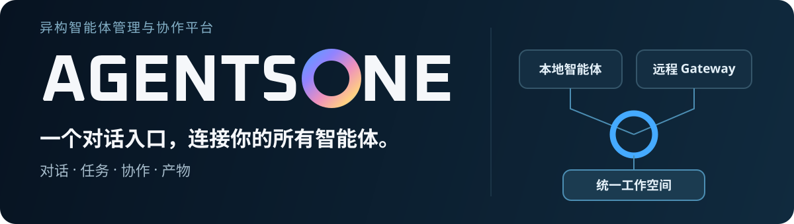

# Agents One

<p align="center">
  
</p>

<p align="center">
  <a href="README.md">English</a> · <a href="#产品一览">界面预览</a> · <a href="#快速开始">快速开始</a> · <a href="#参与开发">参与开发</a> · <a href="#许可协议">许可协议</a>
</p>

**AI 智能体管理与协作平台。** 统一接入 Pi Agent、Codex、Claude Code、OpenCode 等本地智能体，以及通过 Gateway 连接的远程智能体，集中管理对话、任务、协作与产物。每个智能体保留自己的工具与权限，而你的工作集中在同一个对话界面。

> **Windows x64 · 0.1.0。** 安装版与便携版见 [Releases](https://github.com/pkulyn/agents-one/releases/tag/v0.1.0)，启动前请核对 SHA-256。

**MIT 开源。** Windows 核心功能验收已通过；远程 Hermes 多轮记忆与重启续接仍为实验性功能。详见[已知问题](KNOWN_ISSUES.md)。

## 让智能体协助安装与配置

如果你的智能体可以访问这台电脑，将下面这段话发给它，就可以让它按你的需要协助安装、配置和部署。远程部署还需要你授权它访问相应服务器；手机上的安装、设备配对和必要的登录确认可能需要你操作。

```text
请先阅读 https://github.com/pkulyn/agents-one/blob/main/README.zh-CN.md，
根据我的实际环境协助我安装和配置 Agents One：检查系统和已有工具，
从官方 GitHub Releases 下载适合我的 Windows 或 Android 安装包并核对 SHA-256；
按我的需求接入本地或远程智能体，必要时部署插件、Connector 和 Connect，
并协助手机端安装、连接和配对。先了解我需要哪些功能，不必部署不需要的组件。
请保留现有配置和数据；涉及账号、密钥、服务器权限或必须由我操作的步骤时，
说明需要我做什么，不要把凭据写入源码、文档或日志。
完成后逐项验证，告诉我已完成的内容、验证结果和仍需我处理的事项。
```

## 产品一览

当前版本的启动画面使用 Agents One 的 Dawn Ring 品牌标识：

<p align="center">
  
</p>

真正的工作发生在对话里：项目、定时任务与智能体入口围绕对话组织。

<p align="center">
  
</p>

<details>
<summary>查看智能体注册表</summary>

<p align="center">
  
</p>

</details>

截图来自开发构建，不同版本的文案与布局可能调整。

## 核心体验

| 工作内容       | Agents One 提供什么                                                             |
| -------------- | ------------------------------------------------------------------------------- |
| **对话**       | 流式回复、工具过程、产物、重试与取消、可搜索历史，以及 CLI 原始输出的终端回退。 |
| **智能体**     | 本地 CLI 与远程 Gateway v1 共用一个注册表；健康探测和能力徽章来自实际探测结果。 |
| **项目与任务** | 以文件夹限定工作区，让对话成为任务；支持定时运行、归档和结构化多智能体交接。    |
| **数据自主**   | 可移植备份与恢复，包含完整性校验、凭据排除和回滚保护。                          |

### 保留原生能力，汇入统一界面

Agents One 以原生进程启动本地 CLI。Pi Agent、Codex、Claude Code、OpenCode 等本地智能体保留自己的模型、工具、项目指令与权限模式。远程智能体通过一个 Gateway v1 地址和 Bearer Token 接入，按协议协商能力，工作区访问只在有边界的运行期间授权。两条路径最终都进入同一套对话体验。

[插件 SDK](docs/AGENTS_ONE_PLUGIN_SDK.md) 允许新智能体实现统一契约，无需改动桌面端。[事件流协议](docs/AGENT_EVENT_STREAM_V1.md)承载工具过程、产物与交接；[Gateway 协议](docs/AGENTS_ONE_REMOTE_GATEWAY_V1.md)负责远程运行与工作区授权。

## 快速开始

[Windows 安装](#windows-安装与校验) · [本地智能体](#接入本地智能体) · [远程智能体与服务器](#接入远程智能体先分清组件) · [Android 手机端](#android-手机端安装与连接桌面)

### 当前发布状态

| 组件           | 当前情况                                                                                                                                                                       |
| -------------- | ------------------------------------------------------------------------------------------------------------------------------------------------------------------------------ |
| Windows 桌面端 | [0.1.0 正式 Release](https://github.com/pkulyn/agents-one/releases/tag/v0.1.0)，提供 x64 安装版和便携版；未签名，手动下载安装更新。                                            |
| 最新主分支     | 已加入主动检查 GitHub 新版本和手动下载提示，移除关于页的未签名提示与自动更新开关，并调整设置菜单顺序。**这些提交尚未重新打包进 0.1.0 Release**；Release 包仍显示旧的更新页面。 |
| Android        | [0.1.13-dev-debug APK](https://github.com/pkulyn/agents-one/releases/tag/android-v0.1.13-dev)，Android 8.0 / API 26 起；开发签名、可调试的预发布版本。                         |
| 远程接入组件   | Plugin SDK **0.1.6**、Connector CLI **0.1.0**、Connect 服务 **0.1.1**，均从本仓库部署；当前不依赖已发布的 npm 包或项目托管公共服务。                                           |
| 其他平台       | 当前不提供 macOS、Linux 桌面端及 iOS 的公开安装包。Linux 可用于自行部署远程服务。                                                                                              |

Windows 核心流程已完成验收，不代表全部模型、远程服务、跨版本恢复及手机组合均已验收；具体限制见[已知问题](KNOWN_ISSUES.md)。

### Windows 安装与校验

1. 从[官方 Release](https://github.com/pkulyn/agents-one/releases/latest)下载以下两种包之一，同时下载同一版本的 `SHA256SUMS.txt`：
   - `agents-one-0.1.0-setup.exe`：普通用户推荐，按向导安装到当前用户目录，不要求系统级安装权限。
   - `agents-one-0.1.0-portable.exe`：无需安装，放在可写的本地目录后运行。**便携指程序免安装，不代表数据保存在 EXE 旁边**；默认数据位置见下文。
2. 在下载目录打开 PowerShell，检查哈希是否与清单中**相同文件名**的一行一致：

   ```powershell
   Get-FileHash .\agents-one-0.1.0-setup.exe -Algorithm SHA256
   # 选择便携版时，改为对应的 portable.exe 文件名
   Get-Content .\SHA256SUMS.txt
   ```

3. **SmartScreen 说明：** 当前 Windows 包未进行代码签名，首次下载运行可能出现“Windows 已保护你的电脑”或“未知发布者”等提示。这与系统崩溃蓝屏不同，也不是对文件安全性的证明。仅在确认来自本项目官方 Release、哈希一致且信任该版本后，才可选择“更多信息”→“仍要运行”（如系统提供该选项）。若是恶意软件检出、哈希不符，或企业策略禁止运行，应停止并核查，不关闭防护或绕过单位策略。[微软说明](https://learn.microsoft.com/zh-tw/windows/apps/package-and-deploy/smartscreen-reputation)
4. 安装版按向导完成后，从 **Agents One** 快捷方式启动；便携版直接运行 EXE。应用与 CLI 都建议使用普通用户权限。托盘左键单击打开主窗，左键双击切换快捷输入条，再双击即可关闭；右键菜单可正常退出应用。

**更新：** 0.1.0 安装包请手动查看 [Releases](https://github.com/pkulyn/agents-one/releases)。最新源码构建可在**设置 → 关于与更新 → 检查更新**查询新版；发现后按提示去 GitHub 下载、校验并手动安装，不会自动下载安装。关于入口位于日志与诊断下方。升级前在**设置 → 数据**备份，并正常从托盘退出；安装版和便携版的数据目录不同，切换方式不会自动共用数据。当前没有已上架的 winget 或 Microsoft Store 安装入口。

### 接入本地智能体

Agents One 不包含各 CLI 的服务订阅，也不会代替它们登录、配置模型或提供 API Key。先在运行桌面端的**同一 Windows 用户**下安装并配置所需 CLI，确认能在终端完成一次普通对话：

| 智能体类型  | 常见命令   | 接入前检查                                               |
| ----------- | ---------- | -------------------------------------------------------- |
| Codex       | `codex`    | 已完成该 CLI 自身的登录或 Provider 配置。                |
| Claude Code | `claude`   | 已完成 Claude Code 自身的认证，所选工作目录可访问。      |
| Pi Agent    | `pi`       | Pi 的 Provider、模型与凭据已经配置。                     |
| OpenCode    | `opencode` | Provider / 模型能正常使用；桌面端接入使用原生 CLI 协议。 |

1. 打开侧栏**智能体 → 新增智能体**，选择**本地**，再选择对应类型、名称和头像。
2. 在连接设置中使用自动检测到的可执行路径；检测失败时选取真实的 CLI 启动文件，而不是项目目录、安装器或一整段 Shell 命令。Windows 可先用 `where.exe codex`、`where.exe claude`、`where.exe pi` 或 `where.exe opencode`定位。
3. 保存，执行连接检测，确认健康状态与能力；然后在聊天中新建对话，选择该智能体发送一条简单消息。
4. 需要处理文件时，先创建并选择**项目**、确认项目目录，再选合适权限。**只读 / 自动 / 完全访问**的可用操作不同；自动模式限制移动或删除原有文件，完全访问应在理解影响后使用。具体工具是否可用以当前 Runtime 实际支持和检测结果为准。

更改 CLI 安装路径或用户 PATH 后，请完全退出并重开桌面端。若终端正常而桌面检测失败，优先检查启动文件路径、桌面进程继承的环境和同一用户的认证状态。本地 Hermes 的已有安装可在对应管理页发现、选择和采用；不要用远程 Gateway 表单填写本地 Hermes Home。

### 接入远程智能体：先分清组件

| 组件                   | 部署位置                           | 作用                                                                                                                  |
| ---------------------- | ---------------------------------- | --------------------------------------------------------------------------------------------------------------------- |
| Gateway 插件 / Adapter | 实际运行远程智能体的服务器         | 将原生任务、事件、文件和取消操作转换成 Agents One Gateway v1；SDK 提供契约与宿主，不会自动把任意 Agent 变成可用服务。 |
| Connector CLI          | 远程智能体服务器                   | 通过出站 WSS 连接 Connect，把请求转给本机已配置的 Gateway。                                                           |
| Connect 服务           | 桌面端和远程服务器均可访问的服务器 | 配对、设备授权和隧道路由；**不负责安装或执行智能体**。可与 Gateway 同机，状态与凭据需分别管理。                       |

Hermes / OpenClaw 等服务必须已经实现 **Agents One Gateway v1**。普通模型 API、OpenAI 兼容接口、原生聊天网页或某个 Agent 的任意 HTTP 端口，都不能直接作为 Gateway。SDK 的 Hermes 示例是集成骨架，需要服务维护者接入真实运行和产物接口。远程 OpenCode Host 仍有独立的实验发布开关；远程 Pi / Codex / Claude Code 不能按已交付 Adapter 对待。

#### A. 在智能体服务器准备 Gateway 插件

使用 Node.js **24+**，从同一仓库版本取得组件。SDK 尚未发布到公共 npm 注册表；不要直接执行 `npm install @agents-one/plugin-sdk` 并假定可用。

```bash
# 在源码仓库根目录；Windows 使用 npm.cmd 也可
npm --prefix plugins/agents-one-plugin run verify
npm pack ./plugins/agents-one-plugin
# 在你自己的 Gateway / Adapter 工程中安装生成的本地文件：
# npm install /absolute/path/to/agents-one/agents-one-plugin-sdk-0.1.6.tgz
```

服务维护者按[插件 SDK 指南](docs/AGENTS_ONE_PLUGIN_SDK.md)和[插件部署说明](plugins/agents-one-plugin/README.zh-CN.md)实现 / 启动 Adapter：配置独立 Gateway Token、受控工作区和持久化 `statePath`，先在服务器本机验证能力探测、一次对话、取消和文件传输。示例 Token 变量名为 `AGENTS_ONE_GATEWAY_TOKEN`，不要把密钥写入 README、仓库或提示词。桌面端升级不会替你升级远端插件。

#### B. 部署 Connect 服务

可在 Linux 服务器以前台用户进程启动；以下是**反向代理后的单实例起点**，不是多租户生产平台的一键部署：

```bash
git clone https://github.com/pkulyn/agents-one.git
cd agents-one
npm ci --ignore-scripts --prefix services/agents-one-connect
mkdir -p "$HOME/.agents-one-connect"
chmod 700 "$HOME/.agents-one-connect"
export CONNECT_HOST=127.0.0.1
export CONNECT_PORT=8788
export CONNECT_STATE_FILE="$HOME/.agents-one-connect/gateway-state.json"
node services/agents-one-connect/bin/agents-one-connect.mjs
```

将你自己的 `https://connect.example.com` 反向代理到 `127.0.0.1:8788`，转发原始请求路径并支持 WebSocket Upgrade；配置受信任的完整 TLS 证书链。公开地址需从桌面端、远程服务器和手机各自网络可达。

健康检查：`https://connect.example.com/connect/v1/health`。保持服务进程运行；重启时保留状态文件。也可使用 `CONNECT_TLS_KEY_FILE` 与 `CONNECT_TLS_CERT_CHAIN_FILE`启用进程内 TLS，详见[服务部署说明](services/agents-one-connect/README.zh-CN.md)。公网部署还需入口访问控制、限流、状态备份和进程管理；当前单实例实现不提供完整账户系统或跨实例共享授权库。

#### C. Connector 校验码配对

在**智能体服务器**的源码根目录安装 Connector 依赖并生成校验码：

```bash
npm ci --ignore-scripts --prefix plugins/agents-one-connector
node plugins/agents-one-connector/bin/agents-one-connector.mjs request-pairing --connect https://connect.example.com --runtime-id my-remote-agent --name "My remote agent" --wait true
```

在**桌面端**启动前设置同一个 Connect 地址；先从托盘退出已有进程，再从此 PowerShell 会话启动你实际安装的 EXE：

```powershell
$env:AGENTS_ONE_CONNECT_ENDPOINT = "https://connect.example.com"
& "C:\path\to\agents-one.exe" # 替换为实际路径；此变量只对本次会话有效
```

打开**智能体 → 新增智能体 → 远程 → 校验码配对**，输入远端显示的 10 位码，核对设备指纹、Runtime 清单和有效期后确认。`--wait true` 会等待并保存完成配对的凭据；若没有使用它，请另运行 `complete-pairing`。使用同一系统用户运行后续 Connector 命令。

确认远端本机已有兼容 Gateway 后，配置回环代理并保持 Connector 前台运行：

```bash
export AGENTS_ONE_LOOPBACK_GATEWAY=http://127.0.0.1:8787
# AGENTS_ONE_GATEWAY_TOKEN 由私有环境 / 密钥管理器注入，必须与本机 Gateway 一致
node plugins/agents-one-connector/bin/agents-one-connector.mjs run --adapter ./plugins/agents-one-connector/adapters/gateway-v1-loopback.mjs
```

在桌面端保存 / 检测远程智能体并测试真实对话。配对成功仅说明设备已授权，**不代表 Gateway 或模型已就绪**。排查时可运行 `status`、`diagnose --connect https://connect.example.com`；完整参数与用户级自启动方法见 [Connector 说明](plugins/agents-one-connector/README.zh-CN.md)。

高级用户可不经 Connect：选择**自托管 Gateway**，填写可达的 HTTPS Gateway v1 地址与独立 Bearer Token，保存并检测。这是“手动直连”，不会显示为 Connect 已配对。不要公开暴露未认证的 Gateway。

### Android 手机端：安装与连接桌面

手机端用于访问已授权的桌面 Owner（数据与执行宿主）；它不等同于把各个 CLI 安装到手机。桌面端必须保持运行、联网且不休眠；Connect 在线不代表桌面任务通道在线。

**安装：**

1. 从 [Android 发布页](https://github.com/pkulyn/agents-one/releases/tag/android-v0.1.13-dev)下载 [agents-one-android-0.1.13-dev-debug.apk](https://github.com/pkulyn/agents-one/releases/download/android-v0.1.13-dev/agents-one-android-0.1.13-dev-debug.apk) 和对应的 [SHA256SUMS.txt](https://github.com/pkulyn/agents-one/releases/download/android-v0.1.13-dev/SHA256SUMS.txt)，无需自行构建。支持 Android 8.0（API 26）及更新版本。
2. 安装前核对 APK 的 SHA-256 与校验文件中同名条目一致：

   ```text
   533d61317743b40f9e584fabaa11b109b387ab1fbc2060894ccc4c2d8f5601f0
   ```

   例如，在 Windows 下载目录运行 `Get-FileHash .\agents-one-android-0.1.13-dev-debug.apk -Algorithm SHA256`。也可以在手机上使用可信的本地文件哈希工具核对。哈希不一致时请停止安装。

3. 将 APK 传到手机或直接在手机下载；按系统提示只为使用的浏览器 / 文件管理器临时允许“安装未知应用”，安装完成后可关闭该权限。

这是**开发签名且可调试**的预发布包，包名为 `one.agents.mobile.debug`。已授权的 ADB 调试连接可能访问应用数据；无需调试时请关闭 USB 调试，避免在此版本中处理敏感数据。覆盖升级需要相同包名和签名证书；不同签名的包可能无法覆盖安装，卸载会删除该手机的本地状态，请先备份需要保留的数据。当前无 iOS 版或应用商店安装链接。

**接入：**

1. 管理员先按 [Connect 的手机授权部署说明](services/agents-one-connect/README.zh-CN.md#手机连接服务与-owner-初始化)启用独立手机服务，并提供 HTTPS 基础地址和该桌面专属的 **Owner 管理密钥**。仅部署 Gateway 配对服务还不够。
2. 桌面端打开**设置 → 手机连接 → 连接服务设置**，填入地址与 Owner 管理密钥，点击**保存并连接**，开启**允许手机连接**。Owner 管理密钥不能使用 Gateway / Connector Token 代替，也不要交给手机。
3. 点击**生成邀请**，在手机 **我的**的连接入口填写同一 HTTPS 地址、邀请和设备名称，发起连接。
4. 核对桌面与手机显示的短语；在桌面端勾选所需权限并**批准设备**，手机完成领取。此邀请与远程智能体的 10 位 Connector 校验码不是同一种凭据。
5. 回到手机查看任务 / 定时任务；发起任务时选择桌面上已配置且获准使用的智能体、项目与执行模式。若缺少执行授权或需要确认，请在桌面核查 / 批准对应策略，不以“已配对”代替执行权限。
6. 手机遗失或停止使用时，在桌面**已配对设备**中撤销访问。撤销访问不等于取消已经运行的任务；已有任务需单独停止。

只显示离线缓存、Owner 离线或“任务通道尚未就绪”时，先检查桌面进程、允许手机连接开关、网络 / WebSocket 转发和服务状态，不要反复删除配对或重置数据。

## 数据与信任边界

桌面状态存放于 Electron `userData`（Windows 通常为 `%APPDATA%\agents-one`）；便携版默认使用 `%LOCALAPPDATA%\agents-one-portable`。启动参数或显式数据路径配置可能改变该位置。项目实际文件仍在所选目录中；各 CLI 保留自己的配置，也可能在桌面数据目录外存储额外数据。备份排除已知凭据与受保护密文，但用户编写的对话、记忆、技能和附件仍可能含敏感信息。

内置的豆包、ChatGPT 和 Grok 浏览器适配器在公开构建中是**默认关闭的实验功能**。启用后，选定的提示词和附件会通过已登录的第三方网页发送。当前边界与限制见[安全策略](SECURITY.md)和[已知问题](KNOWN_ISSUES.md)。

## 参与开发

需要 Node.js **24 或更新版本**。在 Windows 仓库根目录运行：

```powershell
npm.cmd run install:clean
npm.cmd run dev
npm.cmd run typecheck
npm.cmd test
```

完整检查流程见[贡献指南](CONTRIBUTING.zh-CN.md)，使用与排障见[运行手册](docs/AGENTS_ONE_RUNBOOK.md)，版本变化见[变更日志](CHANGELOG.md)。

## 许可协议

本仓库中 Agents One 的原创贡献采用 [MIT License](LICENSE)。保留版权与许可声明即可使用、修改、分发及商用。贡献者保留其自身版权，并且只能提交有权按 MIT 授权的内容。

继承自 `hermes-desktop` 的部分保留上游作者原有的 MIT 声明，见 [THIRD_PARTY_NOTICES.md](THIRD_PARTY_NOTICES.md)。第三方依赖和素材仍遵循各自协议；Oxanium 字体衍生字标的声明及字体协议也从该文件链接。代码许可不授予冒充 Agents One 项目或维护者身份的权利。
