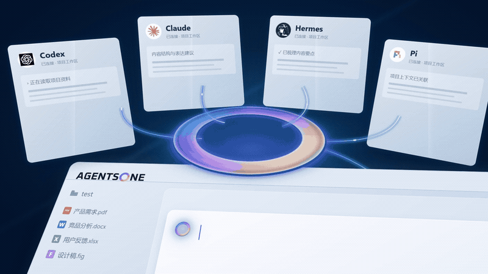

# Agents One

<p align="center">
  
</p>

<p align="center">
  <a href="https://github.com/pkulyn/agents-one/releases"></a>
  <a href="https://github.com/pkulyn/agents-one/actions/workflows/ci.yml"></a>
  <a href="https://github.com/pkulyn/agents-one/releases"></a>
  <a href="LICENSE"></a>
</p>

<p align="center">
  <a href="https://www.agentsone.cn/en.html">官方网站</a> · <a href="https://github.com/pkulyn/agents-one/releases/latest">下载安装</a> · <a href="#产品宣传片">观看宣传片</a> · <a href="#快速开始">快速开始</a> · <a href="README.md">English</a>
</p>

<h2 align="center">从 One 开始，让智能体在此汇聚。</h2>

<p align="center">一个为你工作的智能体，一个容纳更多智能体的工作空间。</p>

**内置自建智能体 One。** 连接你选择的模型 API，即可开始研究、编程与文件处理。也可以接入 Codex、Claude Code、Pi Agent 和 OpenCode，将对话、项目、执行过程与工作成果放在同一个空间里。

## 产品宣传片

<p align="center">
  <a href="assets/readme/product-film.mp4"></a>
</p>

<p align="center"><a href="assets/readme/product-film.mp4"><strong>观看完整版 · 34 秒 · 1080p</strong></a></p>

此处自动预览选段，点击上方入口观看完整版。宣传片用于呈现产品理念与场景，并非当前界面的实机录屏。

## 认识 One

### 你的模型，你的智能体，你的工作方式。

One 是 Agents One 自建的本地智能体，基于 Pi agent SDK 运行，直接连接你配置的模型 API，无需先安装其他智能体 CLI。模型服务与用量由你选择的供应商提供。

- **查资料，也把事情做完。** 联网检索、读取网页、查询天气，处理项目文件，阅读 Word/PDF、创建 Word 文档；选择支持图片输入的模型，还能理解图片。
- **按你的方式工作。** 编辑 One 的 AGENTS.md，管理专属记忆与项目记忆，启用需要的技能，通过插件和 MCP 扩展能力。
- **自由选择模型与思考强度。** 管理供应商与模型，调整上下文和能力信息，按需切换关闭、极低、低、中、高、最高六档思考等级；已确认的思考选择会被记住。
- **执行之中，也能继续交流。** 查看流式答复、原生进展、思考和工具调用；确认发送纠偏消息，在当前工具调用结束后调整方向，或排队到本轮答复后继续跟进。

工具、图片输入和思考能力取决于所选模型、已启用扩展及权限模式；“最高”使用该模型接入所支持的最高强度。

## 一个空间，更多可能

### 留住你熟悉的智能体

One 与 **Codex、Claude Code、Pi Agent、OpenCode** 并列使用。本地接入保留各智能体自己的模型、工具和认证方式，兼容的远程智能体通过 **Gateway v1** 接入。Agents One 尽量保持轻薄的接入层，让原生能力在统一界面中自然呈现。

### 让工作有处可归

选择项目文件夹，继续已有对话，安排定时任务，或将一项任务交给多个已接入的智能体。进展与交接留在对话中，生成的文件通过文档卡片直接打开。

### 随时接近正在进行的工作

查看执行状态，按需停止任务，从可搜索的历史中继续。快捷输入条提供轻量入口；Android 手机端可通过独立配置的连接服务，访问已经授权的桌面端。

## 快速开始

### 1. 安装 Agents One

从 [GitHub Releases](https://github.com/pkulyn/agents-one/releases/latest) 下载 Windows x64 **安装版**或**便携版 EXE**，同时下载对应的 SHA256SUMS.txt。打开前核对文件的 SHA-256：

```powershell
Get-FileHash .\agents-one-<version>-setup.exe -Algorithm SHA256
Get-Content .\SHA256SUMS.txt
```

请替换为实际下载的文件名；便携版以 -portable.exe 结尾。安装版按当前用户安装；便携版无需安装，但数据不保存在 EXE 旁。当前安装包未签名，Windows 可能显示 SmartScreen 提示。可在**设置 → 关于与更新**检查新版，手动下载安装。

### 2. 配置 One

打开**智能体 → 智能体配置 → 模型设置**，选择供应商，配置 API 地址、协议和密钥，选择模型，检测并保存。随后新建 One 对话，发送一条简单消息。

One 支持 OpenAI Chat Completions、OpenAI Responses、Anthropic Messages、Google Generative AI 四种协议；不同供应商的兼容性与可用能力有所不同。API Key 和服务订阅由你自行提供。

### 3. 从一件真实的工作开始

需要处理本地文件时，先选择项目文件夹。让 One 研究一个问题、解释代码，或准备一份文档；核对执行权限，在需要时确认危险操作授权。

<details>
<summary><strong>接入本地智能体</strong></summary>

先在同一 Windows 用户下安装、配置所需 CLI，并确认能在它自己的终端中完成一次对话。

| 智能体      | 启动命令 |
| ----------- | -------- |
| Codex       | codex    |
| Claude Code | claude   |
| Pi Agent    | pi       |
| OpenCode    | opencode |

打开**智能体 → 智能体接入管理 → 新增智能体 → 本地**，选择类型与真实启动文件路径，保存并检测。Windows 可用 where.exe codex（或对应命令）定位。修改 PATH 后需重新打开 Agents One；各 CLI 继续使用自己的登录、供应商配置与服务权限。

</details>

<details>
<summary><strong>接入远程智能体</strong></summary>

远程接入包含运行在智能体服务器上的 **Gateway Adapter**、主动向外连接的 **Connector**，以及负责配对与路由的 **Connect 服务**。也可直连自托管 Gateway。

普通模型 API 地址或聊天网页不是 Gateway。远端需实现 Gateway v1；配对成功不代表模型已就绪，不同适配器的能力和会话续接支持各有边界。

按[插件 SDK 指南](docs/AGENTS_ONE_PLUGIN_SDK.md)、[Connector 部署说明](plugins/agents-one-connector/README.zh-CN.md)和 [Connect 部署说明](services/agents-one-connect/README.zh-CN.md)配置，保持组件版本兼容。SDK 目前未发布到公共 npm 注册表。

</details>

<details>
<summary><strong>使用 Android 手机端</strong></summary>

Android 独立发布为 [0.1.13-dev-debug](https://github.com/pkulyn/agents-one/releases/tag/android-v0.1.13-dev)，支持 Android 8.0 / API 26 及以上。安装前核对该发布页的 APK 校验文件。这是开发签名、可调试的预发布包，当前无 iOS 或应用商店版本。

手机连接已经授权的桌面 Owner，桌面需保持在线。先按 [Owner 初始化说明](services/agents-one-connect/README.zh-CN.md#手机连接服务与-owner-初始化)配置独立手机服务，再通过桌面端**设置 → 手机连接**邀请并批准设备。手机邀请、远程 Connector 配对码、Owner 管理密钥不是同一种凭据；不要把 Owner 管理密钥交给手机。

</details>

<details>
<summary><strong>让你的智能体协助安装</strong></summary>

```text
请先阅读 https://github.com/pkulyn/agents-one/blob/main/README.zh-CN.md，
协助我配置 Agents One。先检查系统环境与当前公开版本，按需配置 One
或接入本地、远程智能体。只安装需要的组件，保留现有数据，不把密钥
写入文件或日志；逐步核验结果，并说明哪些操作需要我亲自完成。
```

</details>

## 围绕你的工作而构建

项目文件保留在你选择的文件夹中。桌面数据使用 Electron userData，Windows 通常为 %APPDATA%\agents-one，便携版默认为 %LOCALAPPDATA%\agents-one-portable。模型 API、远程智能体与启用的扩展会接收完成任务所需的数据。本地执行不是操作系统级沙箱。

权限取决于智能体与模式，删除等危险操作需要明确提醒与授权。升级前请在**设置 → 数据**备份，然后正常退出。完整跨版本升级、回退及全部远程/模型组合尚未完成验收；公开构建中的网页智能体默认关闭，属于实验功能。详见[已知问题](KNOWN_ISSUES.md)与[安全策略](SECURITY.md)。

## 一起构建

Agents One 是开源项目。欢迎完善工作空间、开发适配器，或为智能体扩展更多能力。

```powershell
# Node.js 24+ · 在仓库根目录执行
npm.cmd run install:clean
npm.cmd run dev
```

[贡献指南](CONTRIBUTING.zh-CN.md) · [插件 SDK](docs/AGENTS_ONE_PLUGIN_SDK.md) · [Gateway 协议](docs/AGENTS_ONE_REMOTE_GATEWAY_V1.md) · [运行手册](docs/AGENTS_ONE_RUNBOOK.md) · [变更日志](CHANGELOG.md)

## 许可协议

Agents One 原创贡献采用 [MIT License](LICENSE)。继承代码、依赖、素材与 Oxanium 字体衍生字标保留各自协议及声明，详见 [THIRD_PARTY_NOTICES.md](THIRD_PARTY_NOTICES.md)。

<p align="center"><a href="https://www.agentsone.cn/en.html"><strong>探索 Agents One → www.agentsone.cn</strong></a></p>
